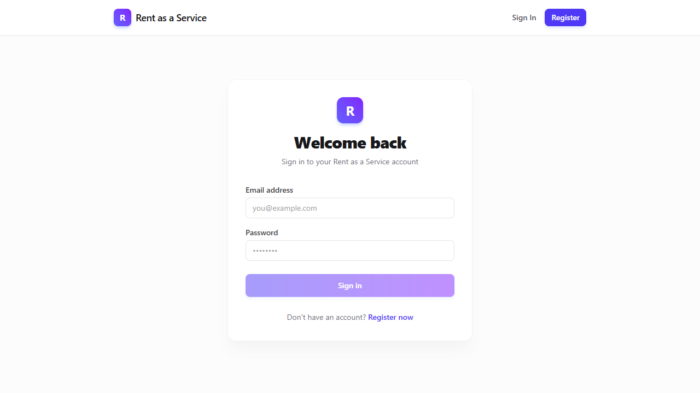
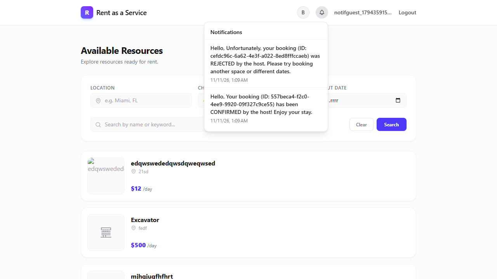

# Validation: in-app-notification-feed

| Level | What was run | Result |
|---|---|---|
| Unit / integration (`ui`) | `npm run test -- --watch=false` and `npm run build` in `ui/` | pass, 6 test files (21 tests: `notification.service.spec.ts` 1, `listing-shell.component.spec.ts` 11, `admin.guard.spec.ts` 5, `app.spec.ts` 2, `auth.service.spec.ts` 1, `admin-tools.component.spec.ts` 1); SSR + browser bundle build succeeded (`496.99 kB` initial, 5 static routes prerendered) |
| Deployment & HTTP Gateway | `kubectl apply -f k8s/apps/gateway/gateway-configmap.yaml`, `powershell -File scripts/redeploy.ps1 -Service gateway`, `powershell -File scripts/redeploy.ps1 -Service ui`, `kubectl -n raas rollout restart deployment/notification-deployment`, `kubectl -n raas get pods`, and HTTP checks against `http://localhost:30000/api/notifications/...` | `gateway-848f58578b-bp8kx`, `ui-deployment-6f9fdff475-7w2sr`, and `notification-deployment` Ready (`1/1 Running`); unauthenticated `GET /api/notifications/user/test-user-id` returned `401`; authenticated `GET /api/notifications/user/7a0e292c-ab16-4aff-b712-2a87ee74f4a6?skip=0&limit=10` returned `200 OK` (`{"total":0,"count":0,"items":[]}` before bookings, `{"total":2,"count":2,"items":[...]}` after `CONFIRMED` + `REJECTED` bookings); authenticated `GET /api/notifications/d7c8431e-f8b4-4464-8c7b-3e135cb5e445` returned `200 OK` |
| Browser E2E (`playwright-cli`) | `playwright-cli open http://localhost:30000/login`, `snapshot`, `fill`, `click`, `console`, `screenshot`, `close` | pass: logged-out header (`login-page.yml`) showed `Sign In` / `Register` with no notification bell; after login as `notifguest_1794359159@example.com`, clicking `[data-testid="notification-bell"]` opened `region "Notifications"` showing `"No notifications yet"` (`empty-notifications.yml`); after confirming booking `557beca4-f2c0-4ee9-9920-09f327c9ce55` and rejecting booking `cefdc96c-6a62-4e3f-a022-8ed8fffccaeb`, clicking the bell rendered both `REJECTED` and `CONFIRMED` notification items with timestamps (`populated-notifications.yml`, `populated-notifications.png`), 0 console errors from notification feed |
| Mobile (`maestro`) | `adb devices`, `maestro --version`, `maestro hierarchy` | `n/a` — RaaS is a web application without an Android/iOS native binary (`adb devices` listed no attached devices; `maestro` `2.12.1` reported `No running devices found`) |

## Command & Tool Output Summary

### 1. Unit Tests & SSR Build (`ui/`)

```text
 RUN  v4.1.1 C:/Users/Krystian/dev/workspaces/Juhasen-RaaS/main-in-app-notification-feed/ui
 ✓  ui  src/app/services/notification.service.spec.ts (1 test) 18ms
 ✓  ui  src/app/pages/admin-tools/admin-tools.component.spec.ts (1 test) 53ms
 ✓  ui  src/app/app.spec.ts (2 tests) 47ms
 ✓  ui  src/app/guards/admin.guard.spec.ts (5 tests) 35ms
 ✓  ui  src/app/services/auth.service.spec.ts (1 test) 39ms
 ✓  ui  src/app/layout/listing-shell.component.spec.ts (11 tests) 148ms
 Test Files  6 passed (6)
      Tests  21 passed (21)
```

### 2. Local Kubernetes Redeploy & Gateway Verification

```text
configmap/gateway-config configured
deployment.apps/gateway restarted
deployment "gateway" successfully rolled out
deployment.apps/ui-deployment restarted
deployment "ui-deployment" successfully rolled out
```

- Unauthenticated request (`curl.exe -s -o NUL -w "%{http_code}" http://localhost:30000/api/notifications/user/test-user-id`): `401`
- Authenticated empty list (`GET http://localhost:30000/api/notifications/user/7a0e292c-ab16-4aff-b712-2a87ee74f4a6?skip=0&limit=10`): `200` `{"total":0,"count":0,"items":[]}`
- Authenticated populated list after `PUT /api/bookings/{id}` (`CONFIRMED` and `REJECTED`):
  ```json
  {
    "total": 2,
    "count": 2,
    "items": [
      {
        "id": "724c00a1-2290-4a6c-b2e2-c705786e430e",
        "user_id": "7a0e292c-ab16-4aff-b712-2a87ee74f4a6",
        "message": "Hello,\n\nUnfortunately, your booking (ID: cefdc96c-6a62-4e3f-a022-8ed8fffccaeb) was REJECTED by the host. Please try booking another space or different dates.",
        "notification_type": "EMAIL",
        "status": "SENT",
        "created_at": "2026-11-11T01:09:42.754619"
      },
      {
        "id": "d7c8431e-f8b4-4464-8c7b-3e135cb5e445",
        "user_id": "7a0e292c-ab16-4aff-b712-2a87ee74f4a6",
        "message": "Hello,\n\nYour booking (ID: 557beca4-f2c0-4ee9-9920-09f327c9ce55) has been CONFIRMED by the host! Enjoy your stay.",
        "notification_type": "EMAIL",
        "status": "SENT",
        "created_at": "2026-11-11T01:09:40.909611"
      }
    ]
  }
  ```

### 3. `playwright-cli` UI Screenshots & Verification Artifacts (`validation/`)

- **Logged out (`http://localhost:30000/login` — [`validation/login-page.png`](validation/login-page.png), [`validation/login-page.yml`](validation/login-page.yml))**:
  
  ```yaml
  - banner [ref=e4]:
    - generic [ref=e5]:
      - link "R Rent as a Service" [ref=e6] [cursor=pointer]:
        - /url: /
      - generic [ref=e9]:
        - link "Sign In" [ref=e10] [cursor=pointer]:
          - /url: /login
        - link "Register" [ref=e11] [cursor=pointer]:
          - /url: /register
  ```
- **Logged in — empty state (`[data-testid="notification-bell"]` clicked)**:
  ```yaml
  - generic [ref=e33]:
    - button "Notifications" [expanded] [active] [ref=e34] [cursor=pointer]
    - region "Notifications" [ref=e351]:
      - generic [ref=e354]: No notifications yet
  ```
- **Logged in — populated state after booking confirmation & rejection ([`validation/populated-notifications.png`](validation/populated-notifications.png), [`validation/populated-notifications.yml`](validation/populated-notifications.yml))**:
  
  ```yaml
  - generic [ref=e33]:
    - button "Notifications" [expanded] [active] [ref=e34] [cursor=pointer]
    - region "Notifications" [ref=e351]:
      - list [ref=e354]:
        - listitem [ref=e355]:
          - paragraph [ref=e356]: "Hello, Unfortunately, your booking (ID: cefdc96c-6a62-4e3f-a022-8ed8fffccaeb) was REJECTED by the host. Please try booking another space or different dates."
          - generic [ref=e357]: 11/11/26, 1:09 AM
        - listitem [ref=e358]:
          - paragraph [ref=e359]: "Hello, Your booking (ID: 557beca4-f2c0-4ee9-9920-09f327c9ce55) has been CONFIRMED by the host! Enjoy your stay."
          - generic [ref=e360]: 11/11/26, 1:09 AM
  ```
- **Mobile Flow (`maestro` — [`validation/maestro-notification-feed.yaml`](validation/maestro-notification-feed.yaml))**:
  Saved reference Maestro flow in `validation/maestro-notification-feed.yaml`.

## Not verified

- Live `maestro test <flow.yaml>` on a mobile device/emulator: RaaS has no native Android/iOS client (`adb devices` returned no devices and `maestro hierarchy` reported `No running devices found`), as noted in the spec's Testing Decisions.
