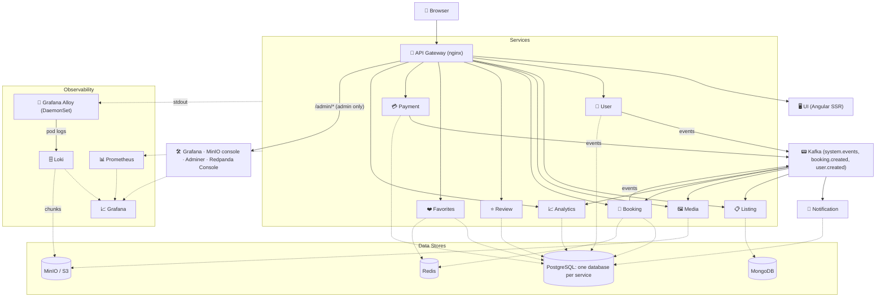

# RaaS – Rental as a Service

### 🚀 Scalable Rental System in a Microservices Architecture

[](https://github.com/)
[](https://github.com/)
[](https://github.com/)

**RaaS** is a distributed marketplace platform (Airbnb/OLX/Otodom clone), designed for flexible rental of any resources (cars, apartments, equipment). The project emphasizes modern design patterns, asynchronous communication, and high availability. It runs on Kubernetes, locally in namespace `raas`.

---

## 🏗️ System Architecture

An nginx **API Gateway** is the single entry point. It serves the Angular UI, routes `/api/*` to the services and checks the user's JWT with the User Service before protected calls (`auth_request`). Services talk to each other asynchronously through **Apache Kafka**.



### Admin tools

The gateway serves the infrastructure UIs at `/admin/grafana/`, `/admin/minio/`, `/admin/adminer/` and `/admin/kafka/`. Every request is checked against the User Service (`/users/admin-check`) and only the `admin` role passes. The JWT is also stored in an HttpOnly cookie so plain links work. Grafana signs the admin in automatically; MinIO and Adminer still ask for their own login. The tools have no NodePorts. The `admin` role cannot be registered: one admin is seeded from the `user-secrets` Secret.

### Observability

Prometheus scrapes each service's `/metrics` plus exporters for PostgreSQL, MongoDB, Redis and Kafka. Grafana Alloy runs on every node, tails the `raas` pod logs and ships them to Loki, which stores its chunks in MinIO. Grafana reads both Prometheus and Loki (dashboards, "RaaS Logs"). See `k8s/infra/monitoring` and `k8s/infra/logging`.

### Delivery

One GitHub Actions pipeline per service (lint, unit tests, image build, push to GHCR on `main`). Specs and validation reports for each change live in `.changes/`.

---

## 📦 Microservices Overview

| Service                  | Responsibility                                                     | Technologies                                |
| :----------------------- | :----------------------------------------------------------------- | :------------------------------------------ |
| **Gateway**              | Single entry point, routing, JWT check, admin tools                | nginx                                       |
| **UI**                   | Web application                                                    | Angular (SSR on Node)                       |
| **Listing Service**      | Listing management (CRUD), categories, availability                | **Go** + MongoDB                            |
| **Media Service**        | Photo upload and management                                        | **Go** + S3 (MinIO locally)                 |
| **Booking Service**      | Booking lifecycle, availability checking (concurrency), saga steps | **Go** + Redis + PostgreSQL                 |
| **Payment Service**      | Payment processing, Stripe integration                             | **Java (Spring Boot)** + PostgreSQL         |
| **Review Service**       | Ratings and reviews                                                | **Java (Spring Boot)** + PostgreSQL         |
| **Favorites Service**    | Wishlist of favorite listings                                      | **Java (Spring Boot)** + Redis + PostgreSQL |
| **Notification Service** | Notifications from events                                          | **Python** + PostgreSQL                     |
| **User Service**         | Registration, login (JWT + cookie), roles, admin check             | **Python** + PostgreSQL                     |
| **Analytics Service**    | Collecting events and statistics                                   | **Python** + Kafka + PostgreSQL             |

---

## ⚡ Asynchronous Communication (Event-Driven)

RaaS implements the **Saga** pattern for bookings. Example flow:

1.  **Booking Service** creates a booking → emits `booking.created`.
2.  **Payment Service** receives the event → processes payment → emits `payment.succeeded` or `payment.failed` on `system.events`.
3.  **Booking Service** updates the status to `confirmed` (or cancels it).
4.  **Notification Service** and **Analytics Service** consume the events (notification to the user, statistics).

---

## 🛠️ Technology Stack

- **Backend:** Java (Spring Boot), Go, Python
- **Frontend:** Angular
- **Databases:** PostgreSQL, MongoDB, Redis, S3-compatible storage (MinIO)
- **Communication:** Apache Kafka (event bus), nginx gateway
- **DevOps:** Docker, Kubernetes (Kustomize), GitHub Actions, Prometheus, Grafana, Loki

---

## 🚀 Quick Start

**Needs:** Docker Desktop with Kubernetes enabled, `kubectl`, PowerShell. Run from the repository root.

```powershell
powershell -File scripts/build-and-start.ps1
```

This builds every image, creates the credentials (`.passwords`, git-ignored, plus the cluster Secrets), deploys the infrastructure and all services, and waits until they are ready. Then open <http://localhost:30000>.

Optional layers, as switches on the same command:

| Switch        | Adds                                                                                            |
| :------------ | :---------------------------------------------------------------------------------------------- |
| `-Monitoring` | Prometheus, Grafana, exporters                                                                  |
| `-Logging`    | Loki and Grafana Alloy (chunks go to MinIO, which the script always deploys)                    |
| `-AdminTools` | Adminer and Redpanda Console; all tools open from `/admin/tools` after logging in as the admin  |

Log in as the admin with `RAAS_ADMIN_EMAIL` and `RAAS_ADMIN_PASSWORD` from `.passwords`.

**Day to day**

```powershell
powershell -File scripts/redeploy.ps1 -Service user   # rebuild one service and restart it
powershell -File scripts/start-local-k8s.ps1          # redeploy manifests without rebuilding images
```

Per-service build, test and deploy commands are in each service's `kubernetes.md` and in `CLAUDE.md`.
